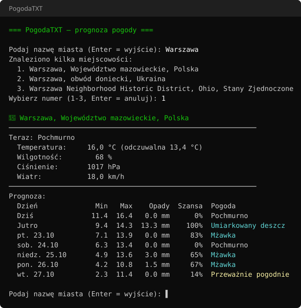

# PogodaTXT

Konsolowa aplikacja do sprawdzania prognozy pogody dla wybranego miasta.

Dane pochodzą z darmowego API [Open-Meteo](https://open-meteo.com), które nie wymaga rejestracji ani klucza API.



*Przykładowy wygląd działania aplikacji (obraz wygenerowany na podstawie rzeczywistych danych z API).*

## Funkcje

- wyszukiwanie miasta po nazwie (z polskimi nazwami miejscowości)
- wybór z listy, gdy nazwa pasuje do kilku miejscowości (np. Kraków w Polsce, USA i Niemczech)
- aktualna pogoda: opis, temperatura i temperatura odczuwalna, wilgotność, ciśnienie, prędkość wiatru
- prognoza na 7 dni: temperatura min/max, suma opadów, szansa opadów, opis pogody
- prognoza godzinowa na najbliższe 24 godziny (co 3 godziny)
- ulubione miasta zapamiętywane między uruchomieniami
- kolorowanie opisów pogody w konsoli
- sprawdzanie kolejnych miast bez ponownego uruchamiania

## Wymagania

- [.NET 10 SDK](https://dotnet.microsoft.com/download)
- połączenie z internetem

## Uruchomienie

```bash
git clone https://github.com/filipdab/PogodaTXT.git
cd PogodaTXT
dotnet run --project PogodaTXT
```

Miasto można podać od razu jako argument:

```bash
dotnet run --project PogodaTXT -- Kraków
```

Można też otworzyć `PogodaTXT.slnx` w Visual Studio i uruchomić projekt klawiszem F5.

## Obsługa

Po wyświetleniu prognozy dostępne są polecenia:

| Klawisz | Działanie |
|---|---|
| `g` | prognoza godzinowa na najbliższe 24 godziny |
| `u` | dodanie miasta do ulubionych lub usunięcie go z nich |
| Enter | powrót do wyszukiwania |

Ulubione miasta są wyświetlane przed pytaniem o miasto – wystarczy wpisać ich numer.
Lista jest zapisywana w pliku `%APPDATA%\PogodaTXT\ulubione.json`.

## Przykład

```
=== PogodaTXT – prognoza pogody ===

Podaj nazwę miasta (Enter = wyjście): Kraków
Znaleziono kilka miejscowości:
  1. Kraków, Województwo małopolskie, Polska
  2. Krakow, Wisconsin, Stany Zjednoczone
  3. Krakow am See, Meklemburgia-Pomorze Przednie, Niemcy
  4. Krakow, Meklemburgia-Pomorze Przednie, Niemcy
  5. Krąków, Województwo łódzkie, Polska
Wybierz numer (1-5, Enter = anuluj): 1

📍 Kraków, Województwo małopolskie, Polska
────────────────────────────────────────────────────────────
Teraz: Pochmurno
  Temperatura:     17,9 °C (odczuwalna 16,1 °C)
  Wilgotność:        55 %
  Ciśnienie:       1014 hPa
  Wiatr:           10,1 km/h
────────────────────────────────────────────────────────────
Prognoza:
  Dzień              Min   Max    Opady  Szansa  Pogoda
  Dziś               7,3  19,3   0,0 mm      0%  Pochmurno
  Jutro              5,6  11,0   8,1 mm    100%  Umiarkowany deszcz
  pt. 23.10          2,9  15,0   0,0 mm      4%  Pochmurno
  sob. 24.10         4,3  13,6   0,4 mm      8%  Mżawka
  niedz. 25.10       3,4  16,0   5,9 mm     61%  Mżawka
  pon. 26.10         4,2  11,3   4,2 mm     66%  Słaby deszcz
  wt. 27.10          1,7  11,3   0,0 mm     12%  Częściowe zachmurzenie

[g] prognoza godzinowa, [u] dodaj do ulubionych, Enter = nowe wyszukiwanie: g

Prognoza godzinowa (co 3 godziny):
  Godzina         Temp    Opady  Szansa      Wiatr  Pogoda
  dziś 14:00      17,9   0,0 mm      0%  10,1 km/h  Pochmurno
  dziś 17:00      18,7   0,0 mm      0%  13,0 km/h  Pochmurno
  dziś 20:00      14,0   0,0 mm      0%  10,4 km/h  Częściowe zachmurzenie
  dziś 23:00      11,4   0,0 mm      0%   7,9 km/h  Pochmurno
  jutro 02:00     10,6   0,0 mm      0%   8,3 km/h  Pochmurno
  jutro 05:00     10,4   0,0 mm      4%   5,8 km/h  Pochmurno
  jutro 08:00     10,5   0,1 mm     78%   6,5 km/h  Mżawka
  jutro 11:00      9,5   0,5 mm    100%  18,4 km/h  Mżawka
```

## Struktura projektu

| Plik | Opis |
|---|---|
| `PogodaTXT/Program.cs` | obsługa konsoli, wybór miasta, wyświetlanie prognozy |
| `PogodaTXT/WeatherClient.cs` | zapytania do API Open-Meteo (geokodowanie, prognoza dzienna i godzinowa) |
| `PogodaTXT/Models.cs` | modele danych odpowiedzi API |
| `PogodaTXT/WeatherCodes.cs` | polskie opisy i kolory kodów pogody WMO |
| `PogodaTXT/FavoritesStore.cs` | zapis i odczyt ulubionych miast |

## Licencja

Projekt jest udostępniony na licencji MIT – szczegóły w pliku [LICENSE](LICENSE).
